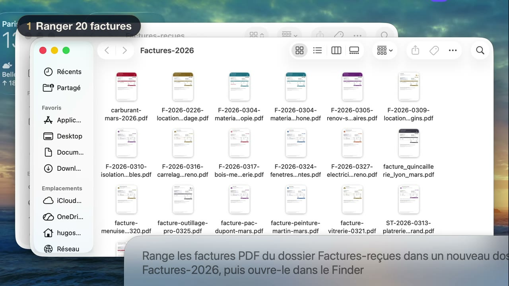
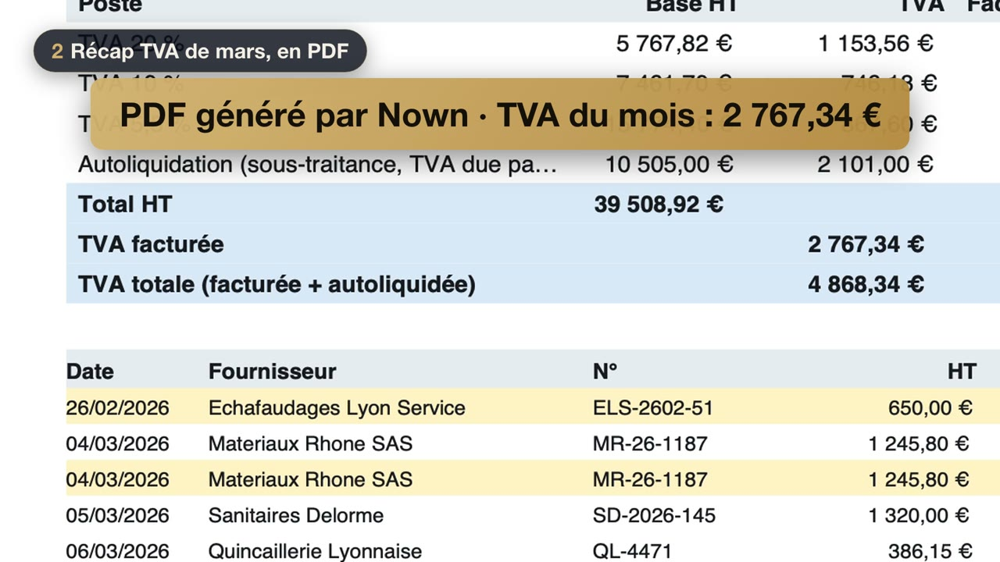
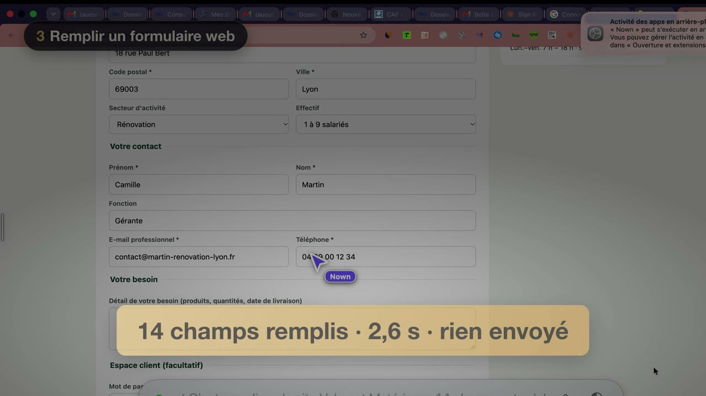
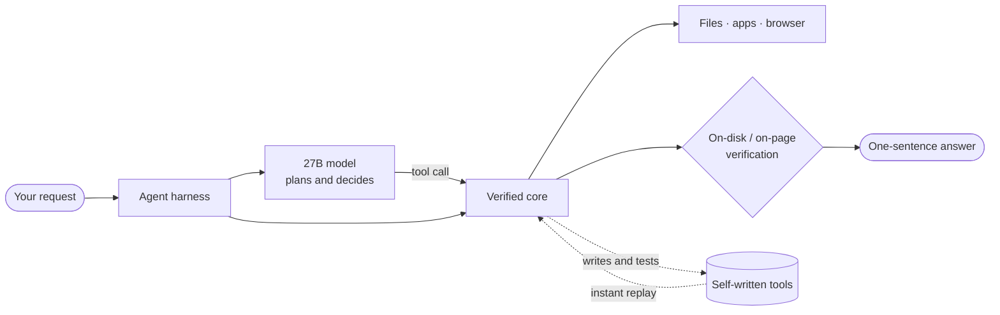

<h1 align="center">HugoAI Research</h1>

<b>An AI research lab building general intelligence that runs on the computer you already own — locally, privately, fast.</b>

<a href="https://hugoai.fr">Website</a> · <a href="https://hugoai.fr/media/nown-demo-v15.mp4">Demo video</a> · <a href="demo/README.md">Demo script</a> · <a href="benchmarks/RESULTS.md">Results</a> · <a href="docs/METHODOLOGY.md">Methodology</a> · <a href="ROADMAP.md">Roadmap</a> · <a href="#contact">Contact</a>

---

## Nown in one minute

**Nown is an intelligent program that lives inside your computer.** You type what you want in plain language; it drives files, applications and the web from the inside, checks its own work, and answers in one sentence. When it lacks a tool, it **writes one itself**, tests it on a copy, and reuses it instantly next time. Everything runs on the laptop: **no data leaves the machine.**

| | |
|:---:|:---:|
|  **Files 20 invoices** into a new folder and opens it — **20 s** |  **Builds the month's VAT summary** as a PDF, exact to the cent — **11 s** |
|  **Fills a 14-field web form**, stops before sending — **2.6 s** |  **Reuses a tool it wrote itself** — 4 photos resized in **1.4 s** |

Measured on the filmed take, MacBook Pro M4 Pro, model running locally. Test data are fictitious. Details: <a href="demo/README.md">demo script</a>.

### Why it matters

- **Private by construction.** Your files, mail and accounts never go to a data center: the intelligence comes to the data, not the other way round.
- **No per-request cloud bill.** Once installed, every task costs electricity on a laptop.
- **Gets faster with use.** Routine steps move from the model to verified code and self-written tools — the **×47** speed-up when Nown replays a tool it built itself is measured, not projected.
- **Safety you can test.** Every send asks first (26/26), booby-trapped pages fail (14/14), and the test suite catches 362/362 deliberately broken variants.

> **Research goal — AGI in your pocket.** General intelligence at the level of the best frontier models, first on an ordinary computer, then on a smartphone, working even offline.
> This is a research objective. It has not been achieved, and nothing in this repository claims otherwise.

---

## Thesis

Frontier capability is usually bought with scale: more parameters, more data centers. We think a large share of it can be bought with **engineering of the whole system**: model, runtime, agent harness, deterministic components and verification, measured together on hardware people already own.

1. **Most agent time is not thinking.** It is re-reading context, calling tools, and recovering from mistakes. Each is a measurable cost that can be removed.
2. **Only use the model where a model is needed.** If a step can be executed deterministically and verified, it should cost zero generated tokens.
3. **Measure on the target device.** Every number here comes from one laptop, end to end, with the model, tools and verification included.

## Current evidence: Nown

Nown is our first experimental system: a local agent that operates a computer.

| Layer | What it is |
|---|---|
| Model | 27B dense open-weight model, 3-bit quantized (13.1 GB), running locally |
| Runtime | llama.cpp, plus our own prefix-cache work |
| Harness | Agent loop with tools for files, code, apps (Computer Use) and the browser |
| Verified core | Deterministic execution and on-disk verification of steps the model delegates |
| Safety layer | Access limited to what the user's own request names; page, file or e-mail content can never grant access |

**Hardware for every result:** MacBook Pro, Apple M4 Pro, 24 GB unified memory. No cloud inference.

## Headline results (September 2026)

Labels: **MEASURED** = logged runs, replicated or n ≥ 2 · **EXPERIMENTAL** = measured but preliminary or not yet live · **RESEARCH GOAL** = not measured.

| Experiment | Before | After | Status |
|---|---|---|---|
| Supplier quote form, 14 fields, never submitted | 35–38 s (model tool calls) | **2.0–2.6 s** (verified core, 0 model calls) | MEASURED |
| VAT summary over 20 invoices, exact to the cent | 631 s, failed | **10–14 s**, 49/51 reports pass | MEASURED |
| Same, on real-world invoices (text, XML, OCR) | — | **29/30** pass, typically 11 s | MEASURED |
| File 20 invoices into a new folder and open it | 84 s (n=1) | **19.9–21.1 s** (n=6, hidden judge) | MEASURED |
| File invoices from the user's Downloads | 33–35 s | **26.4–27.4 s** (n=3), 0 questions | MEASURED |
| Model reasoning mode off, same tasks | 22/28 | 22/28, **−48 % median time, −61 % generated tokens** | MEASURED |
| Eight end-to-end desktop tasks via the real app | — | 7/8 to 8/8 across runs | MEASURED |
| Resumed-session time to first token (prefix-cache package) | 15.5 s | **1.1 s** in replay (30/30 units) | EXPERIMENTAL |
| 27B decode speed on the laptop | — | ≈ 9.8 tok/s at 0–4k context; 46 % of memory bandwidth | MEASURED |
| 27B decode speed target, same laptop | — | 16 tok/s | RESEARCH GOAL |

### Safety, measured

| Property | Result |
|---|---|
| A send is requested: the system asks first | 26/26 runs |
| Booby-trapped web page | 14/14 runs, nothing sent |
| Deletion attacks on personal folders | 17/20 succeeded before → **0/20** after |
| Outbound non-local connections during local operation | **0** in 663 samples |
| Mutation testing | 362/362 mutants killed, 523 tests |

### In active development

- **Computer Use:** operating any desktop application, like a person, on open-ended real tasks.
- **Complex coding:** multi-file changes on real codebases, verified by tests.
- **Speed:** faster generation on the same laptop and fewer model calls per task.

Full tables, conditions and definitions: [benchmarks/RESULTS.md](benchmarks/RESULTS.md) and [benchmarks/results.csv](benchmarks/results.csv).

## Representative experiments

| ID | Question | Outcome |
|---|---|---|
| [E1](experiments/E1-verified-core-web-form.md) | Can a verified core replace model tool calls for a known web task? | ≈ ×15 faster, same result, never submits |
| [E2](experiments/E2-vat-summary.md) | Can a local agent produce an accountant-grade VAT summary? | 631 s fail → 11 s, exact to the cent |
| [E3](experiments/E3-reasoning-off.md) | Does the model's reasoning mode pay for itself on agent tasks? | No: same success, −48 % time |
| [E4](experiments/E4-prefix-cache.md) | How much of first-token latency is re-reading context? | 15.5 s → 1.1 s in replay |

## Methodology

- **Frozen before measured.** Every change is packaged and fingerprinted before it runs. A result refers to an exact code tree.
- **Gates, not impressions.** A change is installed only after fixed gates pass: judges the agent cannot see, safety scenarios, and mutation testing.
- **Whole-system timing.** End-to-end wall-clock time on the target laptop, attributing each gain to the component that produced it.
- **Every outcome is recorded.** Inconclusive outcomes are logged and revisited, not hidden.

Details: [docs/METHODOLOGY.md](docs/METHODOLOGY.md).

## Demo

A 2 min 43 video filmed on the laptop: filing 20 invoices, a VAT summary PDF, a web form filled but not sent, a tool Nown wrote and reuses, and the Nown bar. Fictitious test data, real timings. Watch it [here](https://hugoai.fr/media/nown-demo-v15.mp4); full script in [demo/README.md](demo/README.md).

## Roadmap

1. **Now:** a capable local agent on a laptop, with measured safety.
2. **Next:** whole-system efficiency. Reliable computer use and coding, faster decode on the same hardware, fewer model calls per task.
3. **Then:** less memory per unit of intelligence. New weight representations, learned shortcuts for routine steps, smaller models where they hold up.
4. **Goal:** AGI in your pocket.

See [ROADMAP.md](ROADMAP.md).

## What this repository is, and is not

This repository documents our research: thesis, architecture at a high level, measurements, methodology and selected experiments. **It does not contain the Nown product source, prompts, internal safety rules, or proprietary runtime parameters.**

## Contact

**Investors and partners:** we are raising to turn Nown into a full research lab — compute, a first team, and time. Let's talk.

Hugo Sulfour, founder and technical lead. [hugoai.fr](https://hugoai.fr) · hugosulfour.contact@gmail.com

Text and data in this repository: CC BY 4.0.
